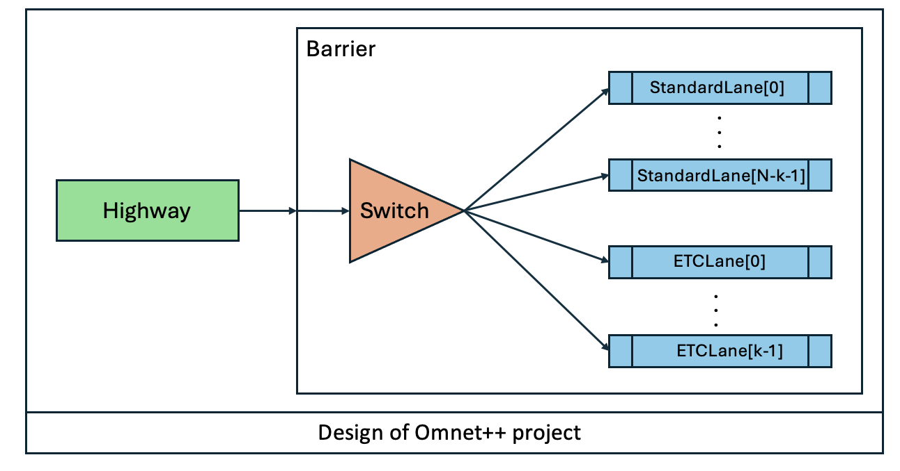
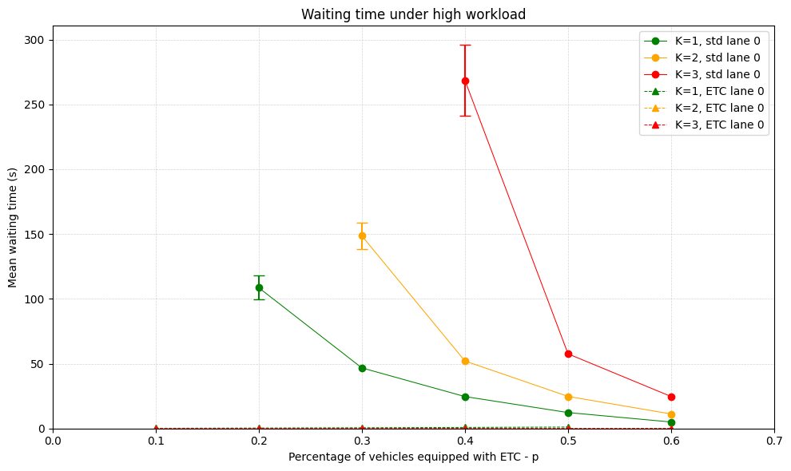
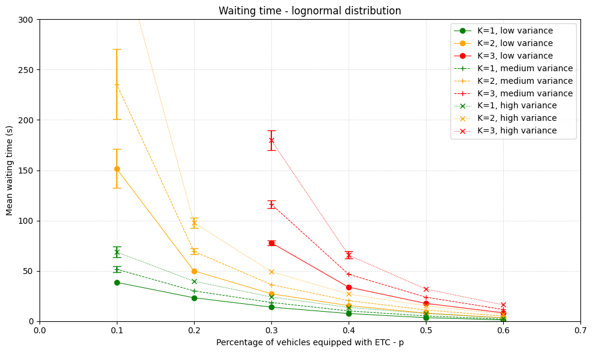

# Queueing Simulation of a Highway Toll Barrier with ETC Lanes

A queueing-theory study of a highway toll barrier, carried out by discrete-event simulation in [OMNeT++](https://omnetpp.org/). The barrier is modelled as a set of parallel single-server queues fed by Poisson arrivals and join-the-shortest-queue routing; some lanes are reserved for vehicles equipped with an Electronic Toll Collection (ETC) device. The study measures how waiting and response times change with the number of ETC lanes, the share of ETC-equipped vehicles and the traffic workload.

University project for the **Performance Evaluation of Computer Systems and Networks** course (Computer Engineering).

**Authors:** Klaudio Çaça, Gabriele Caioli, Alessio Simoncini

---

## Overview

The barrier has **N** lanes, **K** of which accept only ETC-equipped vehicles; the other N − K are *standard* lanes.

- Vehicles are either **cars** or **trucks**, arriving with exponentially distributed interarrival times of mean **Tc** and **Tt**.
- A fraction **p** of vehicles carries an ETC device.
- Each vehicle joins the lane with the **shortest queue** among those it is allowed to use.
- **Standard lanes:** service time **S** for cars and **1.5 · S** for trucks. S is either **exponential** or **lognormal**.
- **ETC lanes:** constant service time **S_etc**, the same for every vehicle.

The performance indexes are:

- **Mean waiting time E[W]**: from arrival at the barrier to the start of service.
- **Mean response time E[R]**: from arrival at the barrier to the end of service.

These are measured for different combinations of **K** and **p**, under low, medium and high workload, with both service-time distributions.

## Queueing model

- **Arrivals:** cars and trucks are two independent Poisson processes with rates λc = 1/Tc and λt = 1/Tt. Their superposition is again Poisson with rate λ = λc + λt. ETC-equipped vehicles form a thinned Poisson stream of rate p·λ.
- **Standard lanes:** single-server FIFO queues with infinite capacity. Their service time is a mix of S (cars) and 1.5·S (trucks), so each lane is a ·/G/1 queue. With exponential S the mix is a two-branch hyperexponential; with lognormal S the variance is controlled through σ.
- **ETC lanes:** single-server FIFO queues with deterministic service S_etc (·/D/1).
- **Routing:** join-the-shortest-queue (JSQ) among the lanes a vehicle may use. Because of JSQ, the arrival process seen by each lane is no longer Poisson and the lanes are not independent. Simulation is used because there is no simple closed-form solution for E[W] and E[R].
- **Stability:** with K > 0, the offered load per standard lane is

  ρ_std = (1 − p) · (λc·S + λt·1.5·S) / (N − K)

  and the system is stable only if ρ_std < 1 (and p·λ·S_etc / K < 1 on the ETC lanes). For example, under high workload (Tc = 9 s, Tt = 90 s, S = 62 s), K = 0 (all traffic on the 8 standard lanes) gives ρ ≈ 0.99, right at the edge of saturation. K = 1 with p = 0.3 lowers it to ρ_std ≈ 0.79, while K = 3 with p = 0.1 pushes it above 1. This is why some (K, p) combinations are unstable and are left out of the charts.

## Model assumptions

- Each vehicle is a job; lanes are FIFO queues with unlimited capacity.
- A vehicle cannot change lane once it has been assigned.
- On ties, the lane with the lowest index is chosen. This makes lane 0 the busiest of its type, so lane 0 is used as the worst case in the analysis.
- With K > 0, ETC vehicles use only ETC lanes and the others use only standard lanes (no hybrid lanes). With K = 0, all vehicles share the standard lanes.
- S_etc > 0. It models the slowdown required to pass through the barrier.

## Implementation



| Module | Type | Role |
|---|---|---|
| `Highway` | simple | Generates cars and trucks with their interarrival distributions and decides whether each one is ETC-equipped. |
| `Barrier` | compound | The system under study: contains the `Switch` and the lanes. |
| `Switch` | simple | Routes each vehicle to the least-loaded lane it is allowed to use. |
| `Lane` | simple (base) | FCFS queue: records the arrival time, serves vehicles and emits waiting/response time, queue length and lane occupancy. |
| `StandardLane` / `ETCLane` | simple | Extend `Lane` with the exponential/lognormal and constant service time, respectively. |

Vehicles are `Vehicle` messages (`isCar`, `hasEtc`, `arrivalTime`). The model uses three RNGs: one for cars, one for trucks (ETC draw plus next arrival, always in sequence) and one for lane service times.

## Methodology

- **Verification:** degeneracy (K = 0, p = 0), consistency (cars only vs. trucks only; arrival and service rates doubled together), continuity (small changes of S) and monotonicity (increasing N) tests.
- **Calibration:** traffic parameters based on public highway traffic data (around 400 vehicles/h at peak, about 10% trucks). The S range was chosen as the point where the system is close to saturation (S ≤ 62 s).
- **Simulation setup:** N = 8, S_etc = 5 s, warm-up 200 000 s, simulation time 1 000 000 s, 35 repetitions per configuration, 95% confidence intervals.

| Scenario | Tc | Tt | S | Distribution of S | K | p |
|---|---|---|---|---|---|---|
| Low workload | 12 s | 120 s | 54 s | exponential | 0–3 | 0.1–0.6 |
| Medium workload | 10.5 s | 105 s | 58 s | exponential | 0–3 | 0.1–0.6 |
| High workload | 9 s | 90 s | 62 s | exponential | 0–3 | 0.1–0.6 |
| Lognormal (σ = 30 / 60 / 90 s) | 10.5 s | 105 s | 58 s | lognormal | 1–3 | 0.1–0.6 |

All scenarios and tests are defined as configurations in [`omnetpp.ini`](HighwayBarrier/simulations/omnetpp.ini).

## Key results

- Adding ETC lanes greatly reduces waiting times for ETC vehicles **and** improves the whole system, because it takes load off the standard lanes.
- High values of K waste capacity: ETC traffic is limited by p and ETC service is fast, so extra ETC lanes stay mostly idle. With N fixed, they also leave too few standard lanes, which then become congested.
- The improvement on standard lanes grows with p, as more traffic moves to the ETC lanes.
- With a lognormal S, a larger standard deviation increases waiting and response times on standard lanes, but the behaviour as K and p vary stays the same.
- For a medium-sized barrier, **one ETC lane out of eight** is a reasonable ratio, in line with real toll plazas.

| Waiting time — high workload (exponential S) | Waiting time — lognormal S |
|---|---|
|  |  |

The full analysis is in the [documentation](docs/Documentation.pdf) and the [presentation](docs/Presentation.pdf).

## Repository structure

```
.
├── HighwayBarrier/           # OMNeT++ project (simulator)
│   ├── src/                  # modules (.cc/.h/.ned) and Vehicle.msg
│   └── simulations/          # network, omnetpp.ini, run script
├── analysis/                 # result analysis
│   ├── pre_simulations.ipynb # verification tests, calibration, warm-up estimation
│   ├── experiments.ipynb     # exponential and lognormal experiments
│   ├── jsonFiles/            # simulation results exported to JSON
│   └── graphs/png/           # generated charts
└── docs/                     # documentation and presentation (PDF), module diagram
```

## Getting started

### Requirements

- OMNeT++ 6.x
- Python 3 with `numpy`, `scipy`, `matplotlib` and `jupyter`

### Build and run the simulator

From an OMNeT++ shell (or import `HighwayBarrier/` into the OMNeT++ IDE):

```bash
cd HighwayBarrier && make makefiles && make MODE=release
```

```bash
cd HighwayBarrier/simulations && ./run -u Cmdenv -c WorkloadHigh omnetpp.ini
```

Replace `WorkloadHigh` with any configuration in `omnetpp.ini`. Results are written to `HighwayBarrier/simulations/results/`.

### Export results and plot

Export the scalars to JSON, either from the IDE (`.anf` file → Browse Data → Scalars → Export → JSON) or with `opp_scavetool`:

```bash
cd HighwayBarrier/simulations && opp_scavetool export -F JSON -o ../../analysis/jsonFiles/Exp_High.json results/WorkloadHigh-*.sca
```

Then open the notebooks:

```bash
cd analysis && jupyter notebook
```

The JSON files used for the charts are already included, so the notebooks can be run without re-running the simulations.
